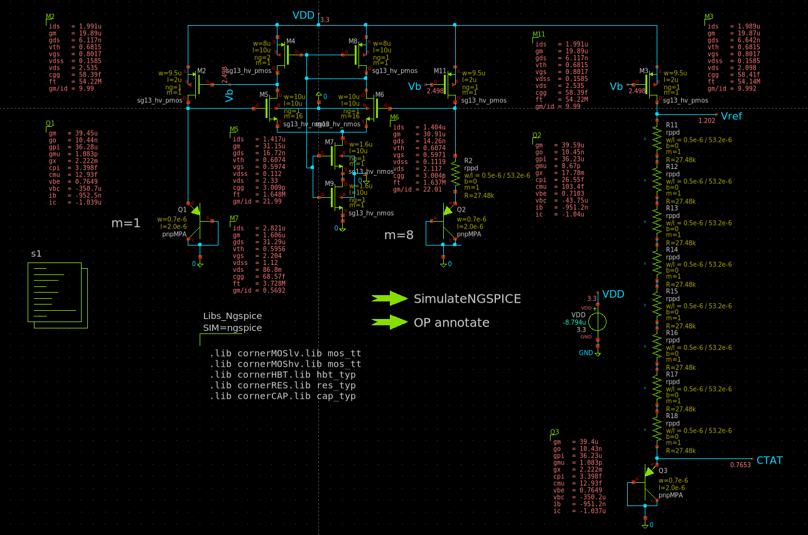
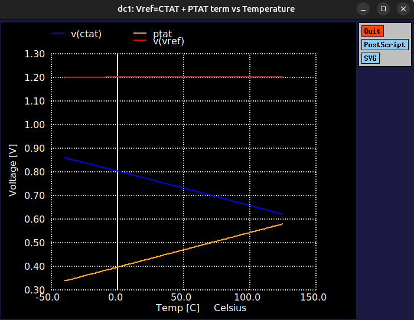
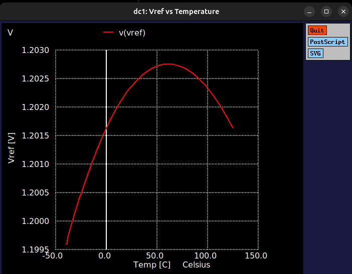
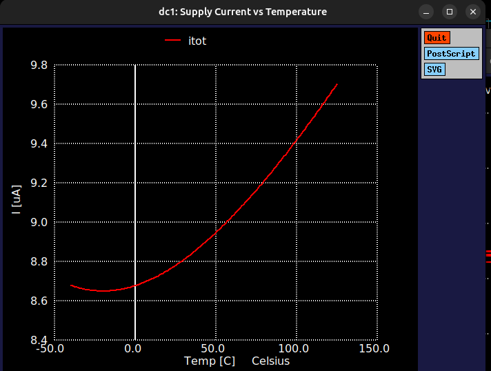
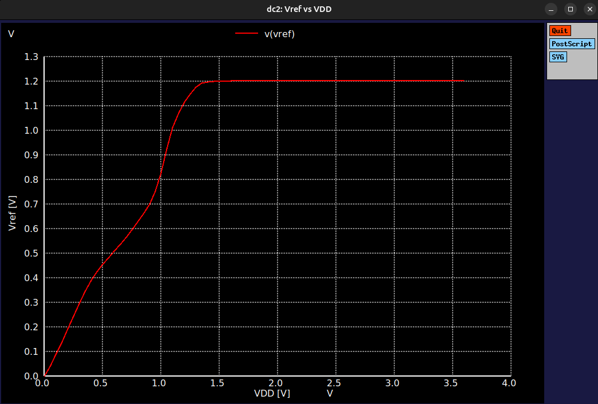
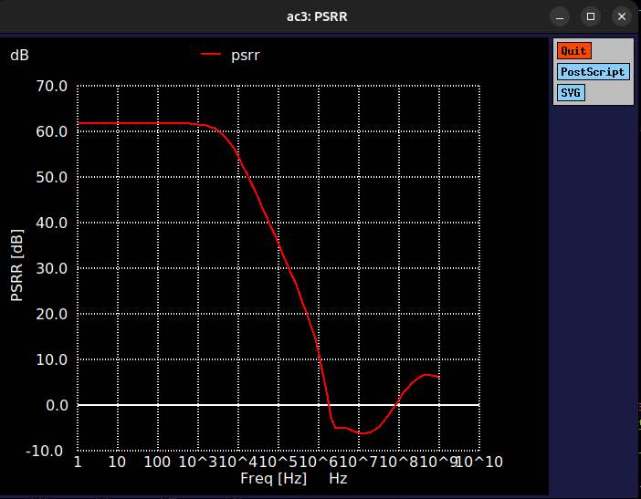

# BGR1V2

Low-power 1.2 V bandgap reference. Supply current under 10 µA.
Designed in IHP technology, simulated with Xschem and ngspice.



## Specifications

| Parameter | Target | Result |
|---|---|---|
| Output voltage (27 °C) | 1.2 V | 1.2024 V |
| Supply current (27 °C) | < 10 µA | 8.79 µA |
| Temperature coefficient (-40 to 125 °C) | | 15.9 ppm/°C |
| Line regulation (2.5 to 3.6 V) | | 0.050 %/V |
| PSRR @ 100 Hz | | 61.8 dB |

Simulated in ngspice at VDD = 3.3 V.

## Results

### Temperature compensation
The CTAT voltage falls and the PTAT term rises with temperature. Their sum gives a flat Vref.



### Vref vs temperature


### Supply current vs temperature


### Vref vs supply voltage


### PSRR


## Repository structure

```
BGR1V2/
├── README.md
├── schematic/   Xschem schematic (.sch)
├── netlist/     Netlist (with the simulation script) and save file
├── images/      Schematic and simulation plots
└── results/     Raw simulation data (not tracked)
```

## How to run

```
cd netlist
ngspice BGR1V2.spice
```

The simulation script in the netlist runs the temperature sweep, supply sweep, Vref vs VDD over temperature, and PSRR. It prints a summary at the end.

## Tools

- [IHP Open PDK](https://github.com/IHP-GmbH/IHP-Open-PDK) for the technology and device models
- [Xschem](https://xschem.sourceforge.io/) for schematic capture
- [ngspice](https://ngspice.sourceforge.io/) for simulation
